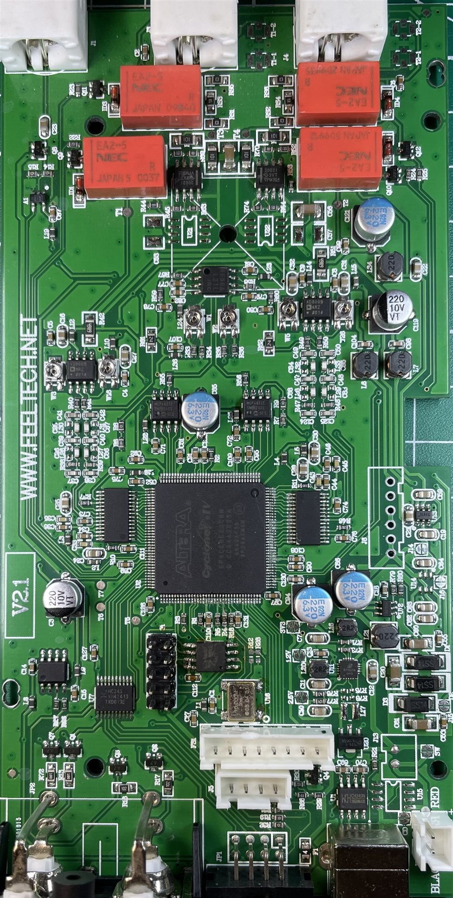
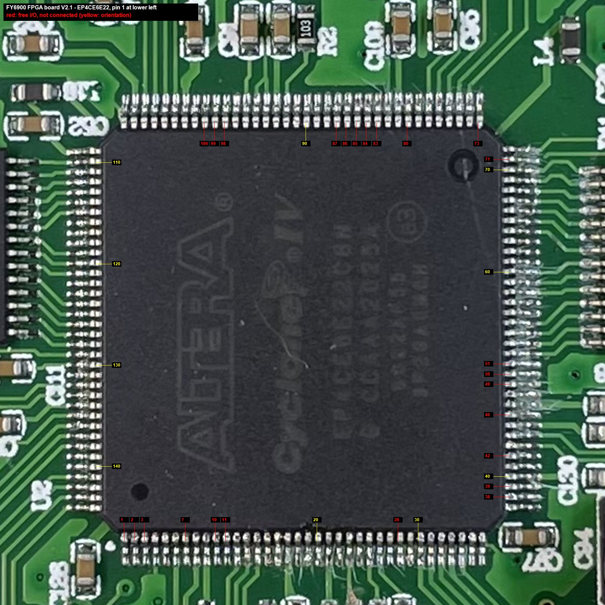

# Hardware

This page describes the FY6900 hardware as far as it matters for the FPGA design. Everything
was measured on one unit: **FY6900 60 MHz with FPGA board V2.1 and front panel board V2.2**
(STM32 firmware 1.8.0).



**Schematics:** there is no published FY6900 schematic, but [DerKammi/FY6600-15-30-50-60M](https://github.com/DerKammi/FY6600-15-30-50-60M) contains a complete
schematic of the closely related **FY6600 main board V1.501** (`Hardware/FY6600_Main_A0.pdf`),
plus the front panel and the power supply. The layout differs, but the FPGA connections
match FPGA boards V1.9 and V2.1 of the FY6900 (compared with this project's pin assignment).
Only the counter input is not drawn there; according to the photos it goes to the same FPGA
pin (135). The schematic is the best reference for the analog output stage, the trimmers and
the power supply.

## Block diagram

```
 front panel board V2.2                         FPGA board V2.1
 ┌────────────────────┐   cable   ┌──────────────────────────────────────────────────────────┐
 │ STM32F103 (LQFP48) │── SPI ────│ EP4CE6E22C8N ──14 bit──> DAC-1412 CH1 ─> filter/amp ─┬─> CH1
 │ display, keys,     │  5 wires  │   │  │  │     ──14 bit──> DAC-1412 CH2 ─> filter/amp ─┼─> CH2
 │ ADC (VCO-IN)       │           │   │  │  │                   ▲ REFI/O (amplitude)      │
 └────────────────────┘           │   │  │  └─ SPI ─> MCP4822 ×2 (amplitude, offset)      │
                                  │   │  └──── range relays ×4 ──────────────────────────┘
                                  │   ├── W25Q16 SPI flash (bitstream + waveforms)
                                  │   ├── 10 MHz TCXO
                                  │   └── 74HC245 ─ rear: Trig IN, Sync IN, Sync OUT, TTL Port A–D
                                  │   Counter input stage (front BNC) ─> FPGA
                                  └──────────────────────────────────────────────────────────┘
```

## Main components (FPGA board V2.1)

| Part | Function |
|---|---|
| Intel/Altera Cyclone IV E **EP4CE6E22C8N** (EQFP-144) | FPGA, 6272 LEs, 30 9-bit multipliers, 270 kbit block RAM |
| **W25Q16JV** | 2 MB SPI flash: FPGA bitstream (Active Serial) + waveform tables. Some FY6900 revisions use a 4 MB **W25Q32** instead (see [below](#spi-flash-w25q16--w25q32)) |
| 10.000 MHz **TCXO** | reference clock, FPGA pin 23 (CLK1) via series resistor |
| 2 × Datel **DAC-1412** | 14-bit, up to 125 MSPS current-output DACs (CH1, CH2), straight binary, latch on the rising clock edge |
| 2 × Microchip **MCP4822** | dual 12-bit DAC per channel: amplitude and offset |
| 4 × NEC **EA2-5** relays | output range per channel ("large" = gain, "small" = attenuator) |
| AD8009 and other op-amps | reconstruction filter and output amplifiers |
| **74HC245** (VCC 3.3 V, /OE = GND) | buffer for the rear-panel digital inputs/outputs |
| JRC4558 | VCO-IN input buffer (voltage follower) |
| CH340 | USB-UART for the PC software (connected to the STM32) |

Front panel board V2.2: STM32F103 (LQFP48), display, keys, rotary encoder. The STM32
samples the VCO-IN voltage with its ADC (PA0) and sends it to the FPGA.

## Clocking

The 10 MHz TCXO feeds PLL1 of the FPGA. The design generates three 125 MHz clocks:

| PLL output | Use |
|---|---|
| clk0 125 MHz | system clock: DDS, register file, flash controller, counter gate |
| clk1 125 MHz, +6 ns | CH2 DAC clock (shifted so that no clock edge coincides with a data transition) |
| clk2 125 MHz | pulse width measurement of the counter |

The CH1 DAC clock is the inverted system clock from a DDR output register. The DAC-1412 is
specified up to 125 MSPS; the original design ran its DDS at 250 MHz (reference registers
0x22:0x23).

## Analog output path

* The waveform DAC (DAC-1412) has a current output; the full-scale current is set by the
  voltage at its REFI/O pin.
* MCP4822 **amplitude** output → 300 Ω / 499 Ω divider → DAC REFI/O. MCP4822 gain 1×.
* MCP4822 **offset** output (gain 2×, centre code 0x7FF) → offset input of the output stage.
* CH1: VOUTA = offset, VOUTB = amplitude. **CH2: swapped** (VOUTA = amplitude, VOUTB = offset).
* Range relays per channel: "large" (gain, from about 6 Vpp) and "small" (attenuator, up to
  about 350 mV); both off = middle range. CMOS and pulse are unipolar waveforms: the DAC
  only uses the upper half (mid scale … full scale) and the firmware doubles the amplitude.
* Trimmers per channel: offset, symmetry, amplitude (see [calibration.md](calibration.md)).

## Rear panel and other I/O

| Connector | FPGA pin | Path / function |
|---|---|---|
| Counter input (front BNC, AC coupled) | 135 | counter input stage → FPGA; counter source "AC", modulation source Ext.(AC) |
| Trig/FSK/ASK/PSK IN (BNC, DC coupled) | 144 | 74HC245 B8 → A8 → FPGA; counter source "DC", modulation source Ext.(DC). Max. about 3.3–5 V |
| Sync IN (BNC) | 143 | uplink slave input |
| Sync OUT (BNC) | 136 | 74HC245 → BNC; CH1 phase reference, uplink master output |
| TTL Port A / B (pin header) | 137 / 138 | CH1 0° / 180° (74HC245, 3.3 V levels) |
| TTL Port C / D (pin header) | 141 / 142 | CH2 0° / 180° |
| VCO IN (BNC) | – | JRC4558 → front panel → STM32 ADC (0–5 V) |
| USB | – | CH340 → STM32 UART (PC software); a USB power supply here also powers the unit for programming with the case open |

## FPGA pin assignment

All 144 pins are listed in [pinout.csv](pinout.csv). Summary:

| Function | Pins |
|---|---|
| 10 MHz clock | 23 |
| SPI from the STM32: MOSI / MISO / SCK / CS / REGSEL | 30 / 31 / 32 / 33 / 34 |
| SPI flash: DCLK / DATA0 / ASDO / nCSO | 12 / 13 / 6 / 8 |
| DAC CH1: clock / D13 (MSB) … D0 (LSB) | 72 / 70, 69, 68, 67, 66, 65, 64, 60, 59, 58, 55, 54, 53, 52 |
| DAC CH2: clock / D13 (MSB) … D0 (LSB) | 129 / 128, 127, 126, 125, 124, 121, 120, 119, 115, 114, 113, 112, 111, 110 |
| MCP4822 CH1: /LDAC / SDI / SCK / /CS | 74 / 75 / 76 / 77 |
| MCP4822 CH2: /LDAC / SDI / SCK / /CS | 103 / 104 / 105 / 106 |
| range relays CH1 large / small, CH2 large / small | 44 / 43, 132 / 133 |
| Counter input / Trig IN / Sync IN | 135 / 144 / 143 |
| Sync OUT, TTL Port A / B / C / D | 136, 137 / 138 / 141 / 142 |
| unconnected I/O | 1, 2, 3, 7, 10, 11, 28, 38, 39, 42, 46, 49, 50, 51, 71, 73, 80, 83–87, 98–100 |



The chip is mounted rotated: pin 1 is at the lower left of the photo, pins 1–36 run along
the bottom edge from left to right, 37–72 up the right edge (CH1 DAC side), 73–108 along the
top edge from right to left and 109–144 down the left edge (CH2 DAC and 74HC245 side). The
trace next to pin 71 is a ground guard for the DAC clock (pin 72), not a connection.
JTAG is not routed on this board.

## Programming header (Active Serial, 10 pins)

Standard Altera AS pinout, verified on the board:

| Pin | Signal | FPGA pin | W25Q16 pin | | Pin | Signal | FPGA pin | W25Q16 pin |
|---|---|---|---|---|---|---|---|---|
| 1 | DCLK | 12 | 6 (CLK) | | 2 | GND | | 4 |
| 3 | CONF_DONE | 92 | | | 4 | VCC 3.3 V | | 8 |
| 5 | nCONFIG | 14 | | | 6 | nCE | 21 | |
| 7 | DATA0 | 13 | 2 (DO) | | 8 | nCS | 8 | 1 (/CS) |
| 9 | ASDO | 6 | 5 (DI) | | 10 | GND | | 4 |

An Intel/Altera USB-Blaster programs the flash through this header in "Active Serial
Programming" mode (see [installation.md](installation.md)). The USB-Blaster does not power
the board. With the case open, power the unit from the rear USB port with a USB power supply
and leave the mains cable unplugged – that is enough for programming, and there is no mains
voltage inside.

## SPI flash (W25Q16 / W25Q32)

The test unit has a W25Q16JV (2 MB). Some FY6900 units are fitted with a W25Q32 (4 MB) –
for example a unit with FPGA board V1.9 ([#2](https://github.com/Marvin-4-2/FY6900_FPGA/issues/2)), so the flash type is not tied to the
board revision. Firmware 1.8.0 is laid out for such a flash (custom waveform slots up to
0x29FFFF, see [firmware-notes.md](firmware-notes.md#custom-waveform-upload)).

A W25Q32 is a drop-in replacement: same SOIC-8 package, pinout and commands. Tested with a
W25Q32 soldered into the V2.1 test unit:

* The USB-Blaster programs and reads it as an **EPCS16**. That covers the first 2 MB; the
  second half stays as it is (empty on a new chip).
* This project's bitstream runs from it. It reads and (from v0.19) writes the flash with
  full 24-bit addresses, so firmware 1.8.0 can use all 64 custom waveform slots.
* The stock bitstream loads from it too, but uses only 21 address bits: its flash writes
  wrap around at 2 MB exactly as on the W25Q16. With the stock bitstream a W25Q32 therefore does
  **not** make firmware 1.8.0 safe. Units that ship with a W25Q32 probably come with a newer
  stock bitstream.
